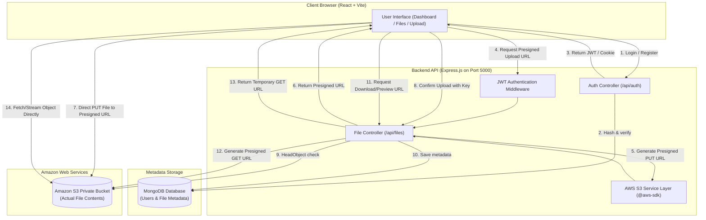

# CloudVault — Personal Cloud File Manager

> A modern, secure, and cost-effective personal cloud storage web application built with **React**, **Node.js**, **Express**, **MongoDB**, and **Amazon S3**.

---

## 1. Project Overview & Features

**CloudVault** is an AWS mini-project designed to deliver a personal cloud storage experience akin to Dropbox or Google Drive. Rather than routing heavy binary files through the Node.js application server, CloudVault uses **direct browser-to-S3 presigned URLs** for maximum throughput, low server overhead, and near-zero bandwidth costs on the Express backend.

### Key Features
- **User Authentication**: Secure registration and login using salted **bcrypt** password hashing and **JWT** (JSON Web Tokens) with HttpOnly cookie support and Authorization headers.
- **Direct-to-S3 Presigned Uploads**: The frontend securely requests short-lived presigned PUT URLs (`PutObjectCommand`), streaming files directly from the browser to a private AWS S3 bucket with real-time upload progress.
- **Tamper-Proof Upload Confirmation**: Backend validates that object keys match the user's namespace (`uploads/:userId/...`) and checks the file's physical existence in S3 (`HeadObjectCommand`) before persisting metadata in MongoDB.
- **Secure Downloads & Inline Previews**: Downloads use temporary presigned GET URLs with `ResponseContentDisposition: attachment`. Preview-supported files (images, PDFs, audio, video) use `ResponseContentDisposition: inline` without ever making the S3 bucket public.
- **Storage Metrics & Analytics**: Aggregated real-time storage stats (total files, storage used in bytes, remaining quota, category breakdown, recent files).
- **File Management & Search**: Instant filename search, category filtering (Images, Documents, Videos, Audio, Archives, Others), sorting by name, size, or date, and pagination.
- **Safe Deletion**: Deletes the file from AWS S3 (`DeleteObjectCommand`) first; only upon S3 success is the metadata removed from MongoDB, preventing orphaned storage objects.
- **Professional SaaS UI**: Built with **Tailwind CSS v4** and **Lucide React** icons, featuring clean card/list views, toast alerts, loading shimmer skeletons, and delete confirmation dialogs.

---

## 2. Technology Stack & Dependencies

### Frontend (`/Frontend`)
- **Framework**: React 19 + Vite 8
- **Styling**: Tailwind CSS v4 (`@tailwindcss/vite`)
- **Routing**: React Router DOM v7
- **HTTP Client**: Axios
- **Icons**: Lucide React

### Backend (`/Backend`)
- **Runtime**: Node.js (ES Modules, `"type": "module"`)
- **Web Framework**: Express.js 5
- **Database & ODM**: MongoDB & Mongoose 9
- **Security**: bcrypt (password hashing), jsonwebtoken (JWT tokens), cookie-parser, cors, dotenv
- **Cloud Storage**: AWS SDK for JavaScript v3:
  - `@aws-sdk/client-s3`
  - `@aws-sdk/s3-request-presigner`

---

## 3. System Architecture



---

## 4. Amazon Web Services (AWS) Setup Guide

### Step 4.1: Create Private Amazon S3 Bucket
1. Open the [AWS Management Console](https://console.aws.amazon.com/s3/).
2. Click **Create bucket**.
3. Choose a globally unique **Bucket name** (e.g., `cloudvault-shivam-storage-2026`).
4. Select your preferred **AWS Region** (e.g., `us-east-1` or `ap-south-1`).
5. **Keep "Block all public access" ENABLED**. (Never make the bucket public).
6. Leave Server-Side Encryption enabled (Amazon S3 managed keys `SSE-S3`).
7. Click **Create bucket**.

### Step 4.2: Configure Bucket CORS (Cross-Origin Resource Sharing)
Since the React frontend uploads directly to S3 from `http://localhost:5173`, S3 must allow PUT requests from your frontend origin:

1. In the S3 Console, click on your bucket name.
2. Navigate to the **Permissions** tab.
3. Scroll down to **Cross-origin resource sharing (CORS)** and click **Edit**.
4. Paste the following CORS configuration:
```json
[
  {
    "AllowedHeaders": [
      "*"
    ],
    "AllowedMethods": [
      "PUT",
      "GET",
      "HEAD"
    ],
    "AllowedOrigins": [
      "http://localhost:5173",
      "http://127.0.0.1:5173"
    ],
    "ExposeHeaders": [
      "ETag"
    ],
    "MaxAgeSeconds": 3000
  }
]
```
*(When deploying the frontend to production, replace `http://localhost:5173` with your production frontend URL, e.g. `https://your-app.vercel.app`)*.

### Step 4.3: IAM User & Least-Privilege Policy
1. Go to the [AWS IAM Console](https://console.aws.amazon.com/iam/).
2. Create an IAM User (e.g., `cloudvault-app-user`) with **Programmatic access**.
3. Attach the following custom inline policy (replace `<your-bucket-name>` with your actual bucket name):
```json
{
  "Version": "2012-10-17",
  "Statement": [
    {
      "Sid": "CloudVaultBucketActions",
      "Effect": "Allow",
      "Action": [
        "s3:PutObject",
        "s3:GetObject",
        "s3:DeleteObject",
        "s3:HeadObject"
      ],
      "Resource": "arn:aws:s3:::<your-bucket-name>/*"
    }
  ]
}
```
4. Generate an **Access Key ID** and **Secret Access Key** for this user.
5. Save these credentials securely in `Backend/.env` (or configure your local `aws configure` CLI profile).

---

## 5. Environment Variables Configuration

### Backend: `Backend/.env`
Create a `.env` file inside the `Backend/` directory (see `Backend/.env.example`):

```ini
# Server Port & Mode
PORT=5000
NODE_ENV=development
FRONTEND_URL=http://localhost:5173

# MongoDB Connection String (MongoDB Atlas or Local MongoDB)
MONGO_URL=mongodb+srv://<username>:<password>@cluster0.example.mongodb.net
# (MONGODB_URI is also accepted as fallback)

# JWT Secret
JWT_SECRET=replace_with_a_strong_random_secret_string
JWT_EXPIRY=7d

# AWS S3 Settings
AWS_REGION=us-east-1
S3_BUCKET_NAME=your-private-s3-bucket-name
# AWS Credentials (if not using AWS CLI default profile ~/.aws/credentials)
AWS_ACCESS_KEY_ID=your_aws_access_key_id
AWS_SECRET_ACCESS_KEY=your_aws_secret_access_key

# Upload & Storage Policies
MAX_UPLOAD_SIZE_MB=10
USER_STORAGE_QUOTA_MB=500
PRESIGNED_URL_EXPIRY_SECONDS=300
```

### Frontend: `Frontend/.env`
Create a `.env` file inside the `Frontend/` directory (see `Frontend/.env.example`):

```ini
VITE_API_BASE_URL=http://localhost:5000/api
```

---

## 6. Local Development Instructions (Windows PowerShell)

### Prerequisites
- Node.js v18+ (tested on v24.22)
- MongoDB instance (MongoDB Atlas free cluster or local MongoDB)
- AWS Account with S3 bucket created

### 1. Install Backend Dependencies
```powershell
cd Backend
npm install
```

### 2. Run Backend Unit Tests
```powershell
cd Backend
npm test
```

### 3. Start the Backend API Server
```powershell
cd Backend
npm run dev
# Starts server with nodemon on port 5000 (http://localhost:5000)
```

### 4. Install Frontend Dependencies & Start Vite Dev Server (in another terminal)
```powershell
cd Frontend
npm install
npm run dev
# Vite runs at http://localhost:5173
```

---

## 7. Backend API Documentation

All responses follow a consistent JSON envelope:
```json
{
  "statusCode": 200,
  "success": true,
  "message": "Human readable status",
  "data": { ... }
}
```

### Authentication Endpoints
| Method | Endpoint | Description | Auth Required |
|---|---|---|---|
| `POST` | `/api/auth/register` | Register a new user (`name`, `email`, `password`) | No |
| `POST` | `/api/auth/login` | Authenticate user & issue JWT cookie / bearer token | No |
| `POST` | `/api/auth/logout` | Clear session cookie | Yes |
| `GET` | `/api/auth/me` | Fetch currently logged-in user profile | Yes |

### File Management Endpoints
| Method | Endpoint | Description | Auth Required |
|---|---|---|---|
| `GET` | `/api/files/stats` | Aggregated storage usage, quota, category counts, and recent uploads | Yes |
| `POST` | `/api/files/upload-url` | Generate presigned S3 PUT URL for user namespace | Yes |
| `POST` | `/api/files/confirm-upload` | Verify uploaded S3 object existence & persist metadata | Yes |
| `GET` | `/api/files` | Query user files with `search`, `category`, `sortBy`, `sortOrder`, `page`, `limit` | Yes |
| `GET` | `/api/files/:id` | Retrieve metadata of specific owned file | Yes |
| `GET` | `/api/files/:id/download-url` | Generate presigned GET URL (`?preview=true` for inline disposition) | Yes |
| `DELETE` | `/api/files/:id` | Remove object from S3 and delete metadata from MongoDB | Yes |

---

## 8. Security Measures

1. **Least-Privilege Cloud Credentials**: AWS credentials exist only on the backend. Frontend only receives temporary presigned URLs valid for 5 minutes (300 seconds).
2. **User Namespace Isolation**: Every S3 object key is forced to prefix with `uploads/:userId/`. The backend verifies namespace ownership during upload confirmation, download URL generation, and deletion.
3. **Double Verification on Upload**: The backend uses S3 `HeadObjectCommand` to verify that the file actually exists in S3 and its size matches before saving the record into MongoDB.
4. **Credential Security**:
   - Password hashing uses `bcrypt` with 10 salt rounds.
   - Plaintext passwords and hashes are omitted (`.select("-password")`) from all JSON responses.
   - HttpOnly cookies prevent XSS theft of tokens.
5. **CORS Restriction**: Backend restricts CORS to the verified frontend origin (`process.env.FRONTEND_URL`) with `credentials: true`.
6. **Path Traversal Protection**: Uploaded file names are strictly sanitized to prevent directory traversal (`../../`) or shell injection characters.

---

## 9. Cost Optimization & Free-Tier Guidelines

As a college AWS mini-project, keeping costs minimal is a core design requirement:

- **AWS S3 Free Tier**:
  - AWS Free Tier includes **5 GB** of S3 standard storage, **20,000 GET requests**, and **2,000 PUT requests** per month for the first 12 months.
- **Offloaded Server Bandwidth**:
  - Because file bytes flow directly between browser and S3, your Express backend requires virtually no RAM or outbound bandwidth for file transfers.
- **Quota Enforcements**:
  - Per-user storage quota (default 500 MB) prevents runaway usage.
  - Max single file upload size (default 10 MB) prevents accidental large uploads.
- **Billing Alerts**:
  - It is strongly recommended to set up an **AWS CloudWatch Billing Alarm** at **$1.00** in the AWS Billing Console to catch unexpected costs.

---

## 10. Troubleshooting

### Issue: "Network Error" when uploading directly from browser to S3
- **Cause**: The S3 bucket's CORS configuration is missing or does not include `http://localhost:5173` with the `PUT` method.
- **Fix**: Update the bucket CORS in the AWS S3 Console as described in **Step 4.2**.

### Issue: "Could not load credentials from any providers"
- **Cause**: AWS credentials are not set in `Backend/.env` or in local AWS CLI.
- **Fix**: Add `AWS_ACCESS_KEY_ID`, `AWS_SECRET_ACCESS_KEY`, and `AWS_REGION` to `Backend/.env`.

### Issue: MongoDB Atlas connection times out
- **Cause**: Network IP is not whitelisted in MongoDB Atlas.
- **Fix**: Go to MongoDB Atlas -> **Network Access** -> **Add IP Address** -> Add current IP (or `0.0.0.0/0` for development).

---

## 11. AWS Resource Cleanup

When you have finished testing or grading the project:
1. Open the [AWS S3 Console](https://console.aws.amazon.com/s3/).
2. Select your CloudVault bucket and click **Empty** to delete all uploaded objects.
3. Click **Delete** to delete the bucket entirely.
4. Open the [AWS IAM Console](https://console.aws.amazon.com/iam/) and delete the created IAM user and access keys.
5. In MongoDB Atlas, pause or delete the sandbox cluster if no longer needed.

